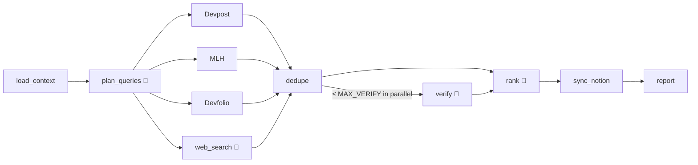

# Hackathon Sniper 🎯 — AI-Powered Hackathon Discovery Agent

> **Hackathon Sniper** is a multi-agent system built with LangGraph that automatically discovers, verifies, ranks, and tracks hackathons in Notion. Point it at the web; it returns only the hackathons worth entering.

**What it does in one sentence:** Hackathon Sniper pulls hackathons from Devpost, MLH, Devfolio and web search, checks each event page for real deadlines and prizes, ranks them against your Notion profile, and keeps a Notion database up to date — once a day, for free, on GitHub Actions.

## Features ✨

- **Multi-agent discovery 🤖** — LangGraph graph with four LLM agents: Query Planner, Extractor, Verifier, Ranker
- **Direct sources 📡** — Devpost, MLH, and Devfolio listings, plus Brave (or SerpApi) web search
- **Verified details 🔎** — reads each event page; deadlines and prizes are kept only when backed by a quote from the page
- **Personal ranking 🎯** — scores events against your Notion profile and past participations
- **Self-maintaining Notion 📊** — upserts by URL, archives closed events, never touches columns you add
- **Free to run 💸** — daily GitHub Actions cron, Groq free tier, hard per-run LLM budget

## Demo 🎬

[](https://youtu.be/eGlTIzBa2hI)

> Demo shows v2 (the TypeScript version, tagged `v2-typescript`).

## Architecture 🏗️



🤖 = LLM agent. Everything else is plain code. See `hackathon_sniper/graph.py`. Notion, search and the LLM are called directly over HTTP (no MCP servers).

## Quick Start 🚀

Prerequisites: [uv](https://docs.astral.sh/uv/), a Notion integration, Groq and Brave API keys.

```bash
make setup                             # install deps, create .env
# fill in GROQ_API_KEY, NOTION_TOKEN, NOTION_HACKATHONS_DB_ID, BRAVE_API_KEY
make setup-notion-dry PARENT=<page>    # preview the Notion changes, writes nothing
make setup-notion PARENT=<page>        # adds columns, creates Participations DB + Profile
# copy the printed NOTION_PARTICIPATIONS_DB_ID / NOTION_PROFILE_PAGE_ID into .env
make dry-run                           # full run, no Notion writes
make run                               # the real thing
```

`<page>` is a Notion page ID or URL. Share it (and the Hackathons DB) with your integration first. Setup is idempotent; if it stops part-way it prints the steps to recover before you re-run. Fill in the Profile page in Notion so the Ranker knows what you like.

## Running daily on GitHub Actions ⏰

1. Add these repository **Secrets** (Settings → Secrets and variables → Actions): `GROQ_API_KEY`, `NOTION_TOKEN`, `NOTION_HACKATHONS_DB_ID`, `NOTION_PARTICIPATIONS_DB_ID`, `NOTION_PROFILE_PAGE_ID`, and `BRAVE_API_KEY` (or `SERPAPI_API_KEY`). To use SerpApi, also add a repository **Variable** `SEARCH_PROVIDER=serpapi`.
2. `Discover hackathons` runs daily at 00:17 UTC; use **Run workflow** for a manual run or dry run. `Live smoke (dry run)` runs a small dry run every Monday.
3. Each run writes a summary (top matches, problems) to the job page. A failed run emails you.

> Public repos: GitHub disables scheduled workflows after 60 days without commits — re-enable from the Actions tab.

> Search quota: the defaults (10 queries/day ≈ 300/month) fit Brave's free credit (~1,000/month). With `SEARCH_PROVIDER=serpapi` (250 free/month), set `MAX_QUERIES=8` (in Actions, add it to the `env:` block of `.github/workflows/discover.yml`).

> Logging: never set `LOG_LEVEL=DEBUG` in Actions for a public repo — SDK debug output can include prompts with your profile text. Store the Notion DB/page IDs as Secrets too, so Actions masks them in request log lines.

> Notion: keep each database single-source. The gateway pins API version 2022-06-28, which can't query or write a database once a second data source is added to it.

## Configuration ⚙️

All settings come from environment variables or `.env`; see [`.env.example`](.env.example).

| Variable | Default | Purpose |
|---|---|---|
| `SEARCH_PROVIDER` | `brave` | `brave` or `serpapi` (needs the matching API key) |
| `GROQ_MODEL` | `llama-3.3-70b-versatile` | Groq model for all four agents |
| `MAX_QUERIES` | `10` | web searches per run |
| `MAX_VERIFY` | `15` | event pages verified per run (`--max-verify N` overrides once) |
| `LLM_CALL_BUDGET` | `60` | hard cap on LLM calls per run |
| `RANK_BUDGET_RESERVE` | `8` | calls verification leaves for the Ranker |
| `LLM_CONCURRENCY` | `2` | parallel LLM calls |
| `REVERIFY_AFTER_DAYS` | `7` | re-check a known event's page after this many days |
| `MLH_SEASON` | blank | blank = current + next MLH season |
| `LOG_LEVEL` | `INFO` | standard Python log level |

Exit codes: `0` ok · `1` run problem (Notion sync broadly failed, half or more sources down, or the run aborted) · `2` configuration error.

## Testing 🧪

```bash
make check   # ruff + mypy + pytest (no network, no API keys)
make eval    # Verifier accuracy on labeled pages (real Groq calls)
```

Golden scenarios in `tests/scenarios/` encode the design rules: duplicates merge, outages never archive, unsupported quotes are dropped, budget exhaustion degrades gracefully, your columns survive, closed events are archived, dry runs never write. Eval cases live in `evals/cases/` (see its README). Run `make help` for every target.

## License 📝

MIT License.
